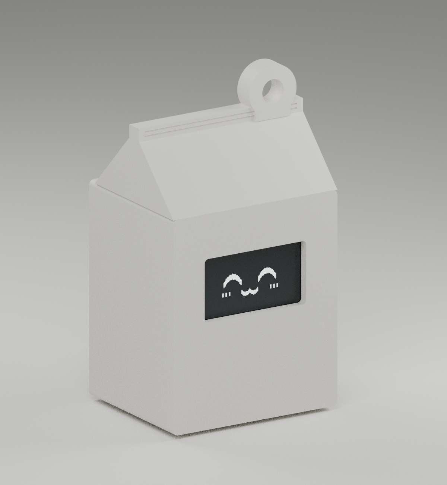
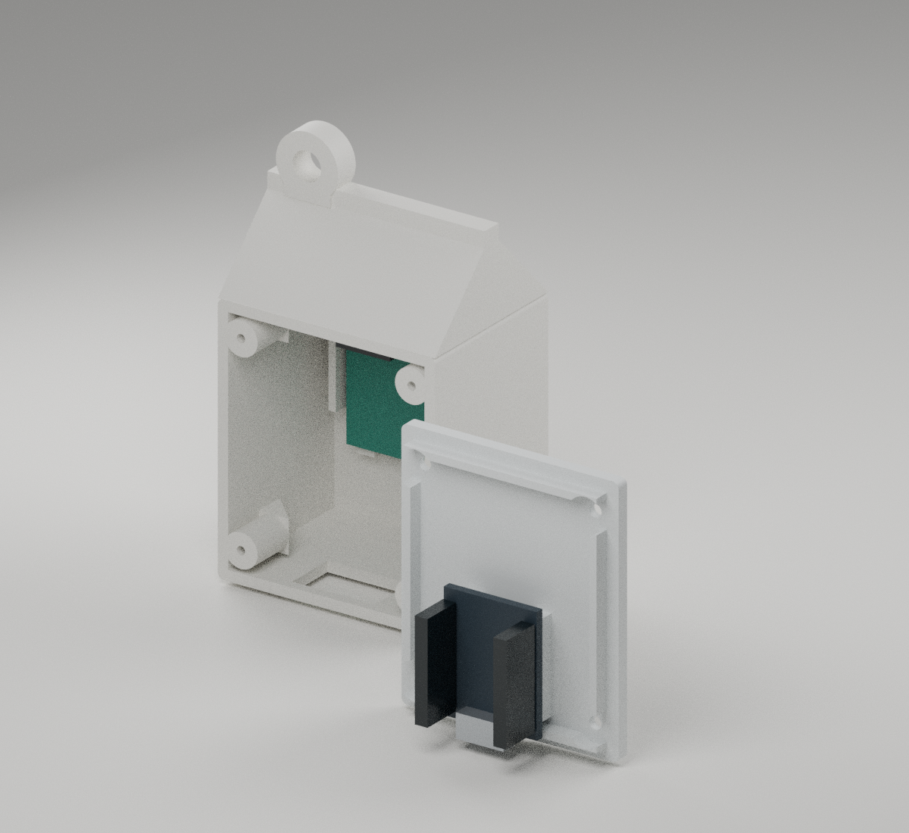

# 우유팩 키링 케이스 · 시험 제작용

[STL 묶음 다운로드](https://raw.githubusercontent.com/themonsteredu/keyring/main/downloads/Milk-Carton-Keyring-STL.zip)

사진의 우유팩 모양을 바탕으로 만든 USB 전원용 본체와 분리형 뒷뚜껑입니다. AAA 홀더 공간은 아직 포함하지 않았습니다. **OLED 판매 도면의 기판 치수를 반영한 시제품**이며, 실물 장착과 점퍼선 커넥터 크기는 아직 확인하지 않았습니다. 먼저 작은 OLED 시험판을 출력해 화면과 기판이 맞는지 확인하세요.

## 출력할 파일

| 파일 | 용도 |
| --- | --- |
| [oled_fit_check.stl](../../downloads/milk-carton/oled_fit_check.stl) | 먼저 출력할 OLED 시험판, 36 × 36 × 8.2mm |
| [milk_case_body.stl](../../downloads/milk-carton/milk_case_body.stl) | 앞면·우유팩 지붕·키링 고리가 합쳐진 본체 |
| [milk_case_lid.stl](../../downloads/milk-carton/milk_case_lid.stl) | 뒷뚜껑 |
| [milk_case_assembly.step](../../downloads/milk-carton/milk_case_assembly.step) | CAD 편집용 조립 모델 |

STL은 **mm 단위, 100% 크기**로 불러옵니다. 본체와 뚜껑을 각각 1개 출력합니다. STEP은 조립 상태이며 STL과 출력 방향이 다릅니다.

## 치수와 준비물

| 항목 | 설계 치수 |
| --- | --- |
| 조립 외형 | 가로 42 × 높이 약 75 × 두께 34.4mm, 고리 포함 |
| 벽 / 뚜껑 | 2.0 / 2.4mm |
| OLED 창 | 26 × 14.5mm; OLED의 실제 발광 영역 치수와는 다름 |
| 기준 OLED 기판 | 27.178 × 27.94mm, 판매 도면의 1.07 × 1.10인치 |
| 기준 ESP32-C3 SuperMini 기판 | 18 × 22.5mm |
| USB 구멍 | 가로 16 × 깊이 방향 10mm |
| 키링 구멍 / 고리 두께 | 지름 5.5 / 두께 5mm |
| 뚜껑 끼움 여유 | 한쪽당 0.30mm |

전자 부품 외에 **플라스틱용 나사 지름 2 × 길이 8mm 4개**, 작은 드라이버, 절연용 양면 폼테이프가 필요합니다. 키링 줄이나 금속 고리는 별도입니다. 본체의 나사 시작 구멍은 지름 1.6mm, 뚜껑 구멍은 2.4mm, 나사머리 홈은 4.6mm입니다. 나사를 억지로 조이지 말고 출력물에 맞는지 먼저 확인하세요.

측면의 0.06인치 표기는 약 1.524mm지만 치수선이 모호하므로, 기판 두께에는 이 값을 잠정 적용했습니다. 0.44인치 측면 표기만으로 암암 점퍼선까지 꽂은 깊이를 확정할 수 없어, 커넥터 뒤쪽에는 임시로 15.2mm를 비워 검토했습니다. 두께·창 위치·장착 구멍 간격은 실물과 시험판으로 확인합니다.

## 출력 설정

시작 설정은 노즐 0.4mm, 레이어 0.2mm, 벽 3~4줄, 채움 15~20%입니다. PLA로 치수를 먼저 확인하고, 실제 사용용은 PETG도 고려할 수 있습니다. 프린터와 재료에 맞춰 조정합니다.

- **본체:** STL에 저장된 방향 그대로, OLED 창이 있는 앞면을 바닥에 놓습니다. 지붕·고리 아래에는 서포트가 필요합니다. 내부 나사 받침에는 약 45도 경사 보강대를 넣었습니다. 슬라이서에서 추가 서포트가 필요한지 확인합니다. 뒷면이 열려 있어 제거할 수 있습니다.
- **뚜껑:** STL 방향 그대로, 평평한 바깥면을 바닥에 놓습니다. 보통 서포트 없이 출력할 수 있습니다.
- **OLED 시험판:** STL 방향 그대로 출력해 기판·화면·커넥터 간섭을 먼저 확인합니다.

## 조립

1. USB 전원을 빼고 서포트와 구멍 가장자리의 잔여물을 정리합니다.
2. OLED를 앞쪽에 넣습니다. 기준 배치는 **4핀 헤더가 위쪽**입니다. 제공된 도면의 앞면 기준 왼쪽부터 VCC·GND·SCL·SDA이며, ESP32의 3.3V·G·GPIO5·GPIO4에 각각 연결합니다. 화면이 창에 잘 맞도록 위치를 조절하고, 유리 화면을 누르지 않도록 기판 가장자리만 절연테이프로 고정합니다.
3. ESP32는 **USB 단자가 아래쪽**을 향하게 뒷뚜껑 안쪽 받침에 고정합니다. 기준 배치는 약 1mm 폼테이프 여유를 두었습니다. 실제 단자가 아래 USB 구멍과 맞는지 케이블로 먼저 확인합니다.
4. **GND → G, VCC → 3.3V, SDA → GPIO4, SCL → GPIO5**로 연결합니다. 점퍼선이 나사 받침과 뚜껑 사이에 끼지 않게 정리합니다.
5. 뚜껑을 맞추고 나사 4개를 조금씩 번갈아 조입니다. USB를 연결해 화면을 확인합니다.

부품이 맞지 않으면 케이스 전체를 확대하기보다 창 위치·기판 공간을 수정합니다. OLED 기판의 가로·세로, 기판 가장자리에서 화면까지의 거리, 헤더 높이, ESP32 크기와 USB 케이블 머리 크기를 재면 수정에 도움이 됩니다. 배터리·충전 회로 공간은 설계하지 않았습니다.

## CAD 재생성과 검증

CadQuery **2.7.0** 환경에서 저장소 루트의 다음 명령으로 생성합니다.

```sh
python3 cad/milk-carton/build_case.py
```

[build_case.py](build_case.py)의 매개변수를 수정하거나 JSON 파일을 `--parameters 파일.json`으로 넘길 수 있습니다. OLED 기판 치수를 바꾸면 해당 받침과 옆 가이드도 함께 이동합니다. 창 위치와 유리 크기, 보드 단자 위치는 별도로 확인해야 하며, 매개변수 변경 후에는 간섭 검사와 시험 출력을 다시 합니다.

[validation.json](../../downloads/milk-carton/validation.json)에 닫힌 단일 STL, 면 방향·체적, 본체와 뚜껑 및 기준 부품 공간의 간섭 검사 결과가 들어 있습니다. **실제 출력·부품 장착·고리 하중 시험은 아직 하지 않았습니다.**

## CAD 미리보기





생성된 CAD 형상을 렌더링한 그림입니다. 화면의 표정과 색이 있는 기판은 배치 설명용이며 출력할 STL에 포함되지 않습니다. 실물 출력 사진이 아닙니다.
